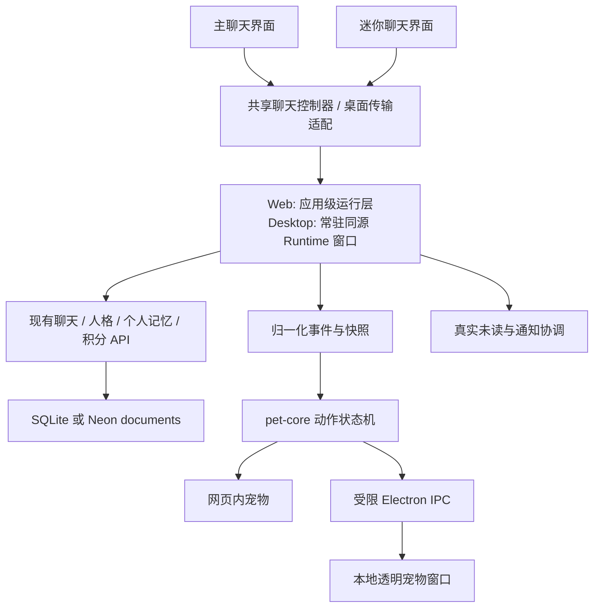

# 忆伴桌宠：产品与实施方案

日期：2026-11-02（北京时间）。性质：基于当前工作区与一手源码的设计方案，尚未实现、安装插件或部署。

## 1. 推荐决定

做一个与现有 AI 伙伴共用身份、会话和记忆的桌宠，提供网页内与 Windows 桌面两种形态。第一版同时交付基础动画、聊天状态联动、迷你聊天、桌面悬浮与退出控制；养成、素材市场、Live2D 放到后续。

技术上沿用项目已有的 Next.js + React + Electron。借鉴 dsh-pet 的动画、动作调度与窗口处理，抽取经过核查的少量 MIT 代码或独立实现；不把 DeepSeek Harness、它的插件宿主或独立聊天服务接进忆伴。

推荐首发一只原创 Q 版「小满」，与现有 AI 陪伴身份衔接。它可以是人的 Q 版，也可以换成动物外观，但外观不是另一个拥有独立记忆的 AI。用户可把某个外观绑定到自己的其他 AI 家人。默认固定绑定小满，开启“跟随当前聊天伙伴”才自动切换。

核心验收场景：用户在主聊天发送一句话 → 桌宠进入等待、回应动画 → 缩到托盘仍可继续 → 点桌宠打开迷你聊天看到同一条回复 → 回复一次只生成一次、结算一次。

## 2. 图片要求如何落地

图片是用户提供的体验参考，图中“可以设计”等文字属于参考内容，不等于本轮要求直接实现。对应设计如下。

| 图片中的想法 | 忆伴的落地方式 | 阶段 |
| --- | --- | --- |
| 眨眼、睡觉、散步、玩耍 | 低频闲置动作；默认停靠，漫游手动开启 | V1 |
| 点击回应、拖动 | 点击打开迷你聊天并播放短回应；拖动只移动，不误触发送或打开 | V1 |
| 聊天状态切换 | 读取真实请求与播放状态，不另问模型“你在做什么” | V1 |
| 桌面透明悬浮 | 复用现有 Electron，增加局部透明窗口 | V1 |
| 直接与桌宠对话 | 共用现有线程、人格、个人记忆、模型与积分链路 | V1 |
| 自定义角色、皮肤 | V1 内置一套原创角色和尺寸/位置设置；后续导入受限素材包 | V1 / V2 |
| 养成与成长 | 可关闭的动作解锁、相处纪念；不缺勤惩罚、不制造亏欠 | V2 |
| Live2D、Spine | 仅预留渲染适配器；另评估运行时许可、性能和素材成本 | V3 |

## 3. 当前项目具备什么，缺什么

以下是工作区源码核查结果，不以旧方案文档中的“尚未实现”为现状。基线 HEAD 为 `49ea169`，聊天、语音等文件还有未提交改动，后续开发应保留这些改动。

| 已有能力 | 证据 | 桌宠如何使用 |
| --- | --- | --- |
| Next.js 16.4.3、React 19.2.4、Electron 44.9.0 的声明依赖 | `package.json` | 不另建桌面技术栈 |
| Electron 打开本地/线上网站，已有沙箱、上下文隔离、导航限制 | `electron/main.cjs` | 增加窗口管理、preload、托盘、生命周期；当前没有桌宠/托盘 |
| 聊天 SSE 与任务恢复 | `components/Chat.jsx`、`lib/chat-generation.mjs`、`lib/sse.mjs` | 复用 start / delta / snapshot / pending / done / error 与 job 查询 |
| 请求幂等、活动任务约束、积分冻结/结算/退款 | `lib/chat-generation.mjs`、`lib/credits.mjs` | 两个入口复用同一发送控制器；保留服务端最终约束 |
| 伙伴设定与个人长期记忆 | `lib/familia-store.mjs`、`lib/personal-memory.mjs` | 桌宠绑定 profileId，不新增第二套人格/记忆 |
| 主动联系、未读、通知 Outbox 与 Web Push 代码 | `lib/proactive-contact.mjs`、`lib/proactive-push.mjs`、`app/api/proactive/[...path]/route.js` | 使用已落库的真实消息；实际离线调度与推送仍取决于部署配置 |
| 原声录音、回复音频与播放入口 | `components/Chat.jsx`、`lib/companion-voice.mjs` | V1 文字迷你聊天；可播放已有音频，语音输入/新合成沿用现有权限与计费 |
| 小满静态插画与受控表情 | `public/companions/`、`lib/companion-chat.mjs` | 可作风格参照/故障占位，不能当作已齐备的全身透明动画 |

最大结构缺口：发送、SSE、草稿、恢复逻辑目前大量放在 `Chat.jsx` 的组件状态里。直接再写一个迷你 Chat 会重复实现，而且组件卸载与请求取消相连。需要先抽离会话运行层，再增加桌宠入口。

本轮已阅读安装版本的 Next.js `route.md` 和 `use-client.md`；实施时继续以 `node_modules/next/dist/docs/` 为准，特别是动态 params、客户端边界和浏览器 API 的使用位置。

## 4. dsh-pet 借鉴与采用边界

完整核查另见 [源码研究记录](../research/2026-11-02-dsh-pet-source-review.md)。研究基于上游 main commit `58a69ba6d0427e6dd4141bee419414020070cea2`；不能把 main 与 `v0.4.0` 标签视为同一份源码。

| 上游设计 | 忆伴的决定 |
| --- | --- |
| 网页/桌面共享动作与物理核心 | 学习，建立不依赖 React/Electron 的 pet-core |
| 透明动画、地面锚点、朝向、过渡 | 学习，统一角色尺寸与脚底，避免切动作闪白/跳动 |
| 每宠物局部窗口、拖拽、屏幕边界 | 学习，首版限制一只，验证 DPI 与多显示器 |
| 工作状态事件驱动动作 | 改为忆伴自己的聊天、未读与音频事件 |
| DSH/Cordis 服务、插件注册、余额接口 | 不采用；当前包存在宿主服务与 React 18 peer 耦合，不适合作为本站直接安装的 UI 库 |
| 独立服务及外部 HTTP/WS 控制 | 首版不需要；Electron 内部用受限 IPC，不增加本地监听端口 |
| 碎碎念与独立对话记忆 | 不另建；只播交互反馈或显示已生成消息，继续使用忆伴聊天 |
| 自带角色、提示词、动画/源视频 | 不作为正式内置素材；使用原创或单独明确授权的素材 |

**必须区分代码与素材许可。** [根 LICENSE](https://github.com/PC2005-cloud/dsh-pet/blob/58a69ba6d0427e6dd4141bee419414020070cea2/LICENSE) 对代码采用 MIT；[README 的许可说明](https://github.com/PC2005-cloud/dsh-pet/blob/58a69ba6d0427e6dd4141bee419414020070cea2/README.md) 对动画、提示词和源视频另设非商用约束，并说明鲸鱼娘形象的非商业许可与衍生署名要求。不能因仓库写 MIT 就打包全部素材。若复制具体代码，逐文件确认许可，保留 copyright 与 LICENSE，记录来源 commit、修改和分发范围。正式素材采用本站原创角色。

## 5. 用户实际怎样使用

### 5.1 开启与绑定

入口放在“陪伴 → 伙伴详情 → 桌宠”，全局设置增加“桌宠与桌面”。默认关闭，首次主动开启才出现。流程只有三步：选伙伴 → 选外观 → 选择网页内/桌面悬浮。

普通网页只提供网页内宠物；“放到桌面”说明需要忆伴桌面版并提供已有安装渠道。手机使用可收起的停靠按钮，不沿屏幕走动、不遮挡底部输入区；手机系统外悬浮不在本方案范围。

桌面模式开启后，同一忆伴客户端内的网页宠物收起，减少重复。单独打开的普通浏览器无法可靠发现 Electron 是否运行，按独立设备偏好处理，不能承诺自动跨应用去重。

### 5.2 日常交互

- 默认在右下角停靠，避开任务栏；网页避开输入框、导航与弹窗。
- 单击：短回应，然后打开迷你聊天。以移动距离区分拖拽和单击；不依赖双击才能使用核心能力。
- 拖动：随手放置，结束时吸附可用边缘；首版不做复杂甩抛物理。
- 右键/键盘菜单：和它说话、回到主聊天、切换伙伴、暂停动作、安静一小时、设置、隐藏。
- 隐藏不等于退出，托盘可找回；托盘另有明确“退出忆伴”。
- 漫游为可选开关，只在工作区边缘低速移动。输入、拖拽、菜单打开、屏幕锁定时停止。

### 5.3 迷你聊天

桌面初始约 360×460 DIP，随字号和屏幕空间调整。头部显示伙伴名、“AI 伙伴”、展开主聊天与关闭；中部呈现最近少量消息；底部文字输入、发送、停止及现行积分价格。样式沿用本站米色背景、深棕按钮与鼠尾草绿用户气泡。

明确显示绑定的伙伴与会话。默认恢复该伙伴上次选定的未归档会话；没有会话时由统一运行层创建一次。打开主窗口定位同一 threadId/messageId，不复制消息、不创建另一段聊天。主动消息也定位原线程，不自动转发进另一线程。

失败保留草稿并给出重试；余额不足进入已有积分入口；模型未配置显示真实状态。V1 不在迷你窗重新做图片编辑、记忆管理、人格编辑等完整功能，跳到主窗口处理。

## 6. 事件联动：真实状态比动画数量更重要

| 真实来源 | 桌宠表现 | 结束/恢复条件 |
| --- | --- | --- |
| 当前会话输入框有输入活动 | 抬头、倾听 | 停止输入约 2 秒后回落；只传播布尔状态 |
| 已提交请求，尚无可见内容 | 等待/思考 | 首个非空可见 delta 或任务终态；不展示推理文本 |
| 正在返回可见回复 | 打字/写字 | 输出停止或进入提交阶段 |
| 正在提交/结算，尚未 completed | 轻等待 | 以真实 job 终态结束，不能提前庆祝 |
| 已播放音频的 play/playing | 说话动画 | pause / ended / error；音频就绪不等于正在播放 |
| 新的真实未读消息 | 举信封一次，保留小角标 | 消息实际可见并完成已读确认；仅看见宠物不算已读 |
| 本轮任务 completed | 点头/短庆祝 | 1—2 秒后回待机；旧消息恢复不重播 |
| failed / 网络异常 | 疑惑，短暂状态提示 | 自动回落；重试由用户明确触发 |
| stopped | 收起动作回到待机 | 不展示失败惩罚 |
| 长时间未交互 | 玩耍/打盹 | 只表示应用交互空闲，不推断用户现实心情 |
| 锁屏/休眠/暂停 | 暂停动画与漫游 | 唤醒先同步快照，再恢复低频行为 |

调度分层：底层是 idle / waiting / generating / committing / speaking 等业务状态；上层是点击、拖拽等短交互；未读角标独立存在。拖拽结束后重新计算当前业务状态，不能恢复一个早已结束的“思考”。未读也不能长期盖住正在生成的状态。

拟定事件字段：`version`、`eventId`、`accountEpoch`、`profileId`、`threadId`、`jobId`、`messageId`、`kind`、`seq`、`occurredAt`、`expiresAt`。绑定账号、伙伴、线程、任务后才消费；切账号增加 epoch 丢弃迟到事件。快照用于恢复，过期事件与重放终态不触发庆祝。每个新 job 的完成反馈最多一次，动画事件不参与计费。

`start` 只表示受理并开始等待；首个有内容的 `delta` 才进入生成。SSE 的 `done` 仍需检查 job.status，不能看到事件名就当成功。`snapshot` / `pending` 与轮询恢复进入同一个 reducer。每个 token 不跨窗口广播，合并到约 100ms 一次或只广播阶段变化。

## 7. 推荐技术架构



### 7.1 一套聊天运行层

把发送、幂等键、SSE、outbox、job 恢复、草稿作用域与停止生成从 `Chat.jsx` 抽到 chat-session 模块。主聊天和迷你聊天只提交意图、订阅快照。不同线程可独立查看；同线程生成沿用服务端互斥。相同消息文本不能当作幂等键，用户确实可能连续发送相同文字。

Web：运行层挂在登录后的应用根部，切页面/收起迷你窗不卸载请求。多标签用 BroadcastChannel 同步提示；服务端仍是最终身份、幂等与活动任务约束。页面全部关闭后不承诺前台请求继续运行。

Desktop：由一个常驻、沙箱化、同部署源的 `/desktop/runtime` 窗口负责 API 请求、SSE 与恢复。主窗/迷你窗通过受限 preload 提交意图到该运行层；不能保留主 Chat 自己发送同时让 runtime 再发一份的双通路。运行层与两个聊天窗共享当前 Electron 登录 session；HTTP-only Cookie 留在会话中，不通过 IPC 读取或传递。

Runtime 是轻页面，不挂完整首页与聊天 UI。它不因主窗隐藏、迷你窗关闭而销毁。首版维持线上后端，不把本地 Node 服务塞进安装包；不导入上游 standalone 的另一套聊天配置。

**关闭与生成的边界必须改清楚：** 当前后端会在响应连接取消时中断生成，`after()` 主要用于生成后的记忆处理，不是持久模型任务队列。因此桌宠版只保证“窗口隐藏但忆伴进程仍运行时继续”；完全退出、系统休眠、断网、进程崩溃可能中断。恢复先查询原 job，状态不明时不自动新建请求。若以后要保证进程退出仍生成，另立服务端持久任务项目。

### 7.2 桌面窗口职责

- **主窗口**：当前网站，增加受限桌面桥。关闭按钮在启用桌宠后隐藏到托盘；首次说明，设置可改为退出。
- **宠物窗口**：打包本地轻量 HTML/JS 与素材，无框透明、局部尺寸、默认不抢焦点、不进任务栏。独立于远程站点加载，离线也可播放待机。
- **迷你聊天窗口**：加载同部署源的 `/pet/chat`，使用同一 session；打开输入时才获取焦点。
- **Runtime 窗口**：同源的网络运行层；无聊天输入焦点，不承担宠物渲染。
- **托盘/主进程**：窗口位置、显示器范围、单实例、退出、锁屏与恢复、允许的 IPC 路由。

Electron 提供透明窗口与鼠标穿透能力，但“背景透明”不会自动让透明部分穿透。应限定小窗口，按交互命中区切换穿透，并提供“完全穿透/停靠”回退；按钮区域与拖动区域分开。Windows 不同缩放、远程桌面、全屏应用下的表现需要实机验证，不能承诺覆盖所有系统窗口。[窗口 API](https://www.electronjs.org/docs/latest/api/browser-window)、[交互说明](https://www.electronjs.org/docs/latest/tutorial/custom-window-interactions)

使用 DIP 与 `workArea` 计算位置，保存 displayId 和归一化位置。屏幕断开、分辨率/缩放变化后把位置夹回现有工作区；启动发现历史位置不可达时回主屏右下角。普通状态不抢键盘焦点，迷你聊天显式激活后才输入。

### 7.3 登录与 IPC 边界

主窗、迷你窗与 Runtime 使用同一默认 session 延续现有登录，避免引入新 partition 后让旧用户丢登录。账号身份仍由服务端 Cookie 校验；IPC 内声称的 userId 不能成为授权依据。退出登录、Cookie 失效、账号切换或伙伴删除时清除窗口可见内容、取消待处理意图并递增 epoch。

桥只暴露特定动作，例如发送聊天意图、订阅当前快照、移动宠物、打开既有会话、隐藏。主进程校验发送窗口身份、顶层 frame、允许 origin/路径、参数和尺寸边界；本地宠物页面也限制为打包资源。保持 `contextIsolation: true`、`nodeIntegration: false`、`sandbox: true`，不暴露 ipcRenderer、文件读写或任意命令执行。远程内容与 IPC 发送者校验以 [Electron 安全文档](https://www.electronjs.org/docs/latest/tutorial/security/) 为依据。

上游为兼容透明窗视频存在关闭硬件加速、GPU sandbox 相关开关及窗口 `sandbox: false` 的实现。这里只把它们作为定位兼容问题的证据，不作为忆伴的默认配置；先在现有沙箱与硬件加速条件下验证，再针对具体缺陷选择局部回退。

### 7.4 未读与通知

将当前挂在 Chat 内的主动联系轮询移到运行层。V1 可增加 `GET /api/pet/state`，按本人返回绑定伙伴摘要、需要恢复的 job、未读计数/最新 messageId 与设置 revision；返回内容有数量上限，并用 private/no-store。已有消息正文继续从聊天接口按权限读取。

单一 Runtime 轮询：迷你窗/主聊天活跃时约 15—30 秒，托盘空闲约 60 秒，失败指数退避至 5 分钟；具体间隔通过实测调整。休眠/断网停止，恢复先拉一次快照；不为宠物创建长连接服务器或每秒扫描全库。现有 documents 存储使用全量过滤的路径需要做有界查询/索引评估，不能假设轮询规模无限。

已有 Web Push 仍可服务浏览器；Electron 的后台未读首版用 Runtime 拉取并按需发原生通知，不假设 Chromium Push 在所有桌面环境都可靠。系统退出后依赖已有浏览器推送条件，不能宣称桌宠仍在线。

通知分三层：真实消息先落库；桌宠角标只是提示；同设备系统通知按 messageId 去重。同一 Electron 内由主进程统一决定系统通知，避免网页和原生重复弹。独立浏览器和桌面客户端的通知偏好按设备保存，跨设备仍可能各提醒一次，若要全账号单次提醒需另加服务端设备送达协调。

迷你窗看到正文、处于前台并确实滚到对应消息后才调用现有 read 接口。免打扰和锁屏默认不显示正文；免打扰期间不跳动、不发声音，角标可静默保留。使用现有主动联系的有效设置，不用新桌宠定时器绕过频率上限。[锁屏/休眠事件](https://www.electronjs.org/docs/latest/api/power-monitor)

## 8. 动画与素材规范

第一版建议 12 个动作：待机、眨眼、挥手、倾听、思考、打字、说话、收到消息、庆祝、疑惑、散步、睡觉。必备 8 个为待机、挥手、倾听、思考、打字、收到消息、疑惑、睡觉；其余缺失时按清单回退，不阻塞核心聊天。

优先使用透明 WebM（VP9 Alpha）或透明 WebP 序列；静态 PNG 回退。首轮先对真实 Electron 与 Edge/Chrome 做透明解码样例验证，其他浏览器先保证静态或兼容序列回退。GIF 仅作低质量备用；Live2D 与 Spine 不进入第一版依赖。

拟定 `pet-pack.json` 字段：schemaVersion、id、name、author、license、attribution、logicalSize、anchor、defaultAction、actions。每动作声明路径、格式、帧率/时长、loop、priority、interruptible、fallback；统一脚底锚点、画幅和安全留白。

加载策略：先待机与占位，再按状态预取；最多当前动作与下一动作双缓冲，不能预载全部解码视频。动作结束后释放闲置解码资源；渲染不可见/锁屏暂停，低电量减少动作。不要全局关闭所有窗口的节流，仅对确有必要的运行层做限制和测量。

后续自定义包只能含校验后的媒体与 manifest，不允许任意 JS/HTML、远程脚本或系统命令。限制压缩包总大小、展开大小、文件数、路径穿越、媒体尺寸/时长与格式；私有自定义包不直接放公开 public 目录。素材元数据保留来源、授权版本与署名。

现有小满插画应先核对资产来源记录与全身化可用性；不能简单用一张头像做位移就宣称有完整桌宠动画。图片中的角色精灵图用于理解动作组织，不直接裁切内置。

## 9. 设置、数据与费用

| 数据 | 建议存放 | 原因 |
| --- | --- | --- |
| 绑定 profileId、外观 packId、通知正文偏好 | 服务端本人作用域的 pet_preferences | 跨设备可恢复，不等于设备自动开启 |
| 开关、网页/桌面模式、位置、尺寸、穿透、托盘关闭策略 | 本设备用户命名空间；Electron userData 的受限设置文件 | 每台屏幕不同，不能同步像素位置 |
| 动作阶段、拖动、鼠标状态、输入布尔 | 内存与短时事件 | 不写长期聊天，不收集输入内容 |
| 消息、任务、个人记忆与积分 | 现有服务端模型 | 保持唯一事实来源 |
| V2 成长数据 | 可选 pet_progress，按本人/伙伴 | 不混入真实家庭记忆 |

新增设置写入继续验证登录、同源、伙伴归属和 revision。先使用现有 documents 抽象，再视查询性能增加索引，不新增 Redis/向量库的部署要求。表名、接口名是拟定，不表示已经存在。

摸摸、拖动、待机、切皮肤、播放已有回复不扣积分、不调用模型。迷你聊天与主聊天按同一现价结算：当前普通陪伴成功回复 1 积分，实施时从服务端 meta 读取而非在桌宠硬编码。声音合成沿用已有定价和用户确认，不因播放说话动画自动触发 TTS。主动联系仍沿用原有预算与免费规则。

## 10. 范围与实施顺序

工作量是按一名熟悉当前项目的开发者估算，不是固定交期；原创角色动画制作可能另需 3—10 个工作日，可与开发并行。当前未提交聊天/语音工作需先确认兼容基线，不能直接覆盖。

| 阶段 | 交付 | 开发估算 | 通过条件 |
| --- | --- | --- | --- |
| P0 可行性与素材样例 | 透明素材样例、窗口穿透/拖动、多屏、共用登录样例 | 1—2 天 | 实机可见、可点、不抢焦点，可明确退出 |
| P1 共享聊天运行层 | 抽离发送/SSE/outbox/恢复，主 Chat 使用新控制器 | 2—3 天 | 原聊天、语音、分支、积分回归；收起 UI 不停止请求 |
| P2 网页宠物与迷你聊天 | 状态机、8 个必备动作、绑定/关闭/低动效 | 2—3 天 | 同线程两入口同步，无额外模型请求 |
| P3 Windows 桌宠 | Runtime、preload、局部窗口、托盘、位置恢复 | 3—4 天 | 主窗隐藏可继续聊天，退出/锁屏/多屏正确 |
| P4 事件、通知与发布验证 | 未读联动、免打扰、错误恢复、安装包与版本协商 | 2—3 天 | 重复/乱序不重播、不重复扣费，安装版复测 |

合计约 10—15 个开发工作日，加上素材与环境适配的不确定性，排期宜预留 2—3 周。正式第一版必须包含 Windows 桌面能力，P2 只是中间里程碑。

V2：自定义媒体包、额外原创角色、主动联系更丰富展示、可关闭成长。V3：Live2D/Spine、多宠物、跨设备连续体验。第一版不引入插件市场、任意脚本插件、屏幕内容理解、全局键盘监听或桌宠自主操作系统。

## 11. 建议文件改动

以下均为后续实施目标，当前只新增方案与研究文档。

```text
components/Chat.jsx                    改为共享会话控制器的主视图
components/ChatSessionProvider.jsx     登录后应用级运行层
components/pet/PetHost.jsx             网页宠物入口与布局避让
components/pet/PetRenderer.jsx         媒体播放、动作过渡、静态回退
components/pet/PetMiniChat.jsx         同一会话的轻聊天视图
components/pet/PetSettings.jsx         绑定、外观、模式与无障碍
lib/chat-session-client.mjs            发送、SSE、outbox、恢复
lib/chat-session-transport.mjs         Web / Electron 意图传输
lib/pet-core.mjs                       纯状态机、优先级与事件归一化
lib/pet-pack.mjs                       manifest 校验与动作回退
lib/pet-preferences.mjs                本人设置与 revision
app/pet/chat/page.jsx                  桌面迷你聊天同源路由
app/desktop/runtime/page.jsx           仅在授权桌面环境激活的运行页
app/api/pet/[...path]/route.js          设置与有界状态摘要
electron/main.cjs                      启动、窗口/托盘生命周期
electron/pet-manager.cjs               多屏、位置、窗口显示与穿透
electron/preload.cjs                   最小桌面桥与订阅清理
electron/pet-renderer/*                打包本地轻量渲染页
public/pets/xiaoman/*                  获准发布的原创媒体与 manifest
package.json                          显式包含桌宠运行所需共享文件/资源
THIRD_PARTY_NOTICES.md                 实际采用代码的来源与许可
```

Electron 目前打包 files 只有 `electron/**/*`。后续如果本地渲染页引用 `lib/pet-core.mjs` 或 `public/pets`，必须新增精确打包路径或构建复制步骤；在干净安装机上确认资源没有依赖开发目录。

网页部署与桌面安装包更新分开：新增透明窗与 preload 需要升级安装包，不能只部署 Vercel。桥提供 capability/version，旧安装包或普通浏览器降级为网页宠物；线上不能向旧 bridge 发送不支持的 IPC。保留独立功能开关以便回退，回退不删除聊天与余额。

## 12. 验收与性能目标

性能数字是待测的工程目标，不是现有结果：动作切换 P95 小于 200ms；本地交互反馈小于 100ms；迷你窗已初始化后打开小于 300ms；本地素材首包尽量不超过 20MB。CPU/内存记录开关前后增量：静止待机 CPU 增量目标低于 2 个百分点，新增桌宠相关进程内存目标低于 200MB，按测试机、缩放、是否动画解码分别报告。若常驻 Runtime 超预算，先收缩页面与解码数量再决定是否改运行层，不隐瞒为“轻量”。

必须完成的检查：

1. 同一账号/伙伴/线程跨主窗和迷你窗一致；另一账号不能读取偏好、未读或消息；删除伙伴后停止订阅。
2. 新请求、重试、重复事件、并行发送、409 活动任务、402 余额不足、401 失效登录；幂等复用且不增加第二笔消费。
3. 首个 delta、分条、completed/failed/stopped、snapshot/轮询恢复；旧完成不庆祝，停止不报错，网络恢复不自动重发。
4. 主窗切页/收起、迷你窗关闭、主窗关闭到托盘时继续；明确退出与断网中止的表现符合说明。
5. 未读只对新消息提醒；实际阅读才已读；免打扰、锁屏、消息已删、旧通知点击均重新验证。
6. 单/双显示器、100/125/150/200% 缩放、拔屏、屏幕负坐标、任务栏换边、睡眠恢复与远程桌面；宠物可找回且不截获无关点击。
7. 无鼠标键盘操作、Esc、焦点返回、200% 字号、减少动态效果、高对比度、纯静态模式；不依赖动作传达唯一信息。
8. 素材损坏/404/不支持透明格式/网络离线时有静态回退，不影响发送聊天。
9. 现有单元测试与重点聊天/语音/积分/主动联系浏览器回归通过，新增状态机与桌面关键路径检查；使用 mock 模型和临时数据，不消耗正式模型额度。
10. `npm.cmd run build`、Windows 打包、干净安装与旧安装包配新网页验证。客户端无密钥、任意文件/命令桥，无开放本地控制端口。

## 13. 推荐首发范围

一只原创小满、网页与 Windows 两形态、8 个必备动作、真实事件联动、同一会话迷你聊天、停靠/拖动、托盘、未读角标、免打扰和低动效。第一版先把“这个角色确实与我正在聊的伙伴是一位，而且状态可信”做完整，再增加更多角色和成长玩法。

本轮交付是可评审方案与上游核查记录；未修改业务代码，也未执行产品测试或生成安装包。
